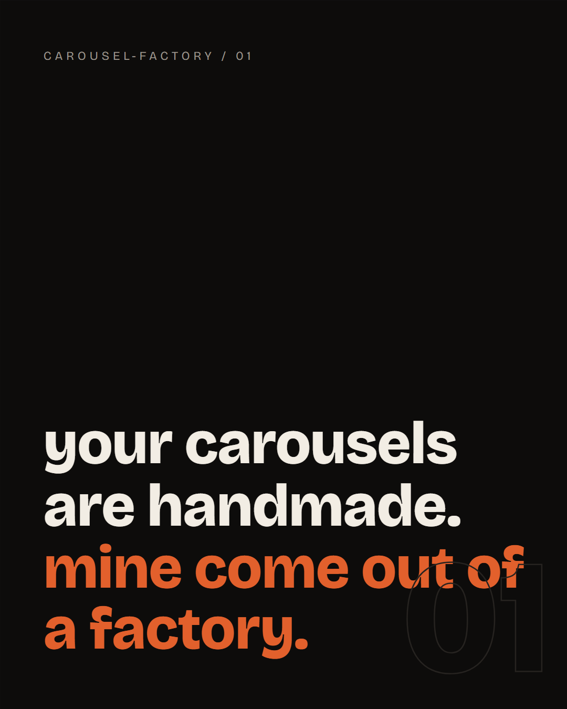

# carousel-factory 🎠

**One HTML file in. A finished Instagram carousel out.**

Stop hand-placing text boxes in a design tool every day. Write your slides as plain HTML divs against one theme block, run one script, and get pixel-perfect 1080×1350 PNGs ready to post.



## Why HTML instead of Canva

Design systems beat design moods. Every slide inherits the same `:root` theme: change `--accent` once and the entire deck restyles. Consistency stops being discipline and becomes physics. It also means an AI assistant can write a complete, on-brand carousel for you in one shot - HTML is its native tongue.

## Quick start

```bash
pip install playwright
playwright install chromium

python export.py            # exports ./carousels/* and ./examples/*
```

Make your own:

```bash
cp -r templates/starter carousels/my-first-carousel
# edit carousels/my-first-carousel/carousel.html
python export.py carousels/my-first-carousel
```

PNGs land in `carousels/my-first-carousel/slides/`.

## How it works

`export.py` (~130 lines) launches a headless Chromium, finds every element with `class="slide"` (or legacy ids `s1..sN`), measures them, and clips a screenshot of each at exactly the output size. `--size 1080x1080` if you want squares.

## The folder convention

Each carousel is a folder shipping FOUR things:

```
my-carousel/
  carousel.md     <- the spec: idea, audience, slide structure (write this first)
  carousel.html   <- the design
  slides/         <- generated PNGs (the factory's output)
  caption.txt     <- the caption. a real one: 800+ chars of context, not "save this!"
```

The slides punch; the caption gives the reader who swiped the satisfaction of depth. Shipping HTML without the PNGs and the caption is shipping a fraction.

## Rules of taste (learned the hard way)

- **One accent color.** Use it like a sniper, not a paintbrush.
- **One idea per slide.** Two ideas = two slides.
- The font IS the brand. Don't ship the default.
- Slide 1 earns the swipe; slide N earns the share. The middle earns trust.
- No "follow for more". Say something worth ending on.

## Example

`examples/meet-the-factory/` is a complete six-slide carousel about the factory itself - spec, HTML, exported slides, caption. Clone it, retheme it, ship daily.

---

Built by [Asadulelah](https://github.com/Asadulelah), who got tired of being his own design intern.
